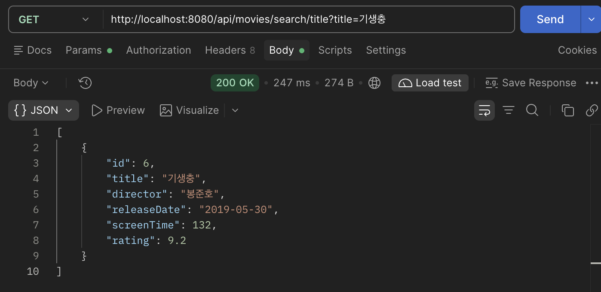
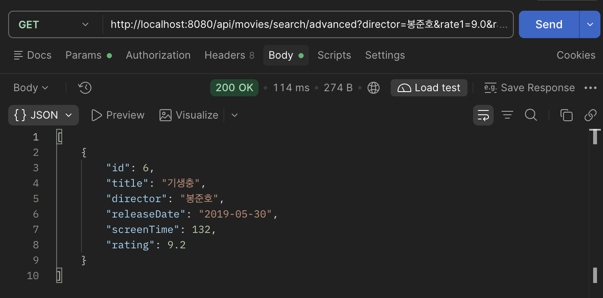
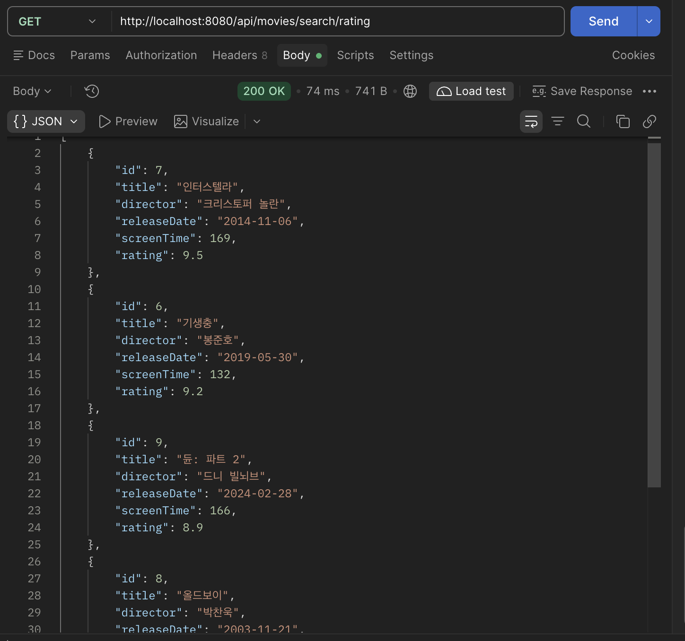
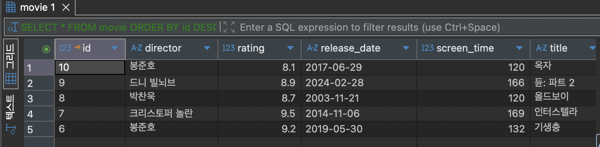
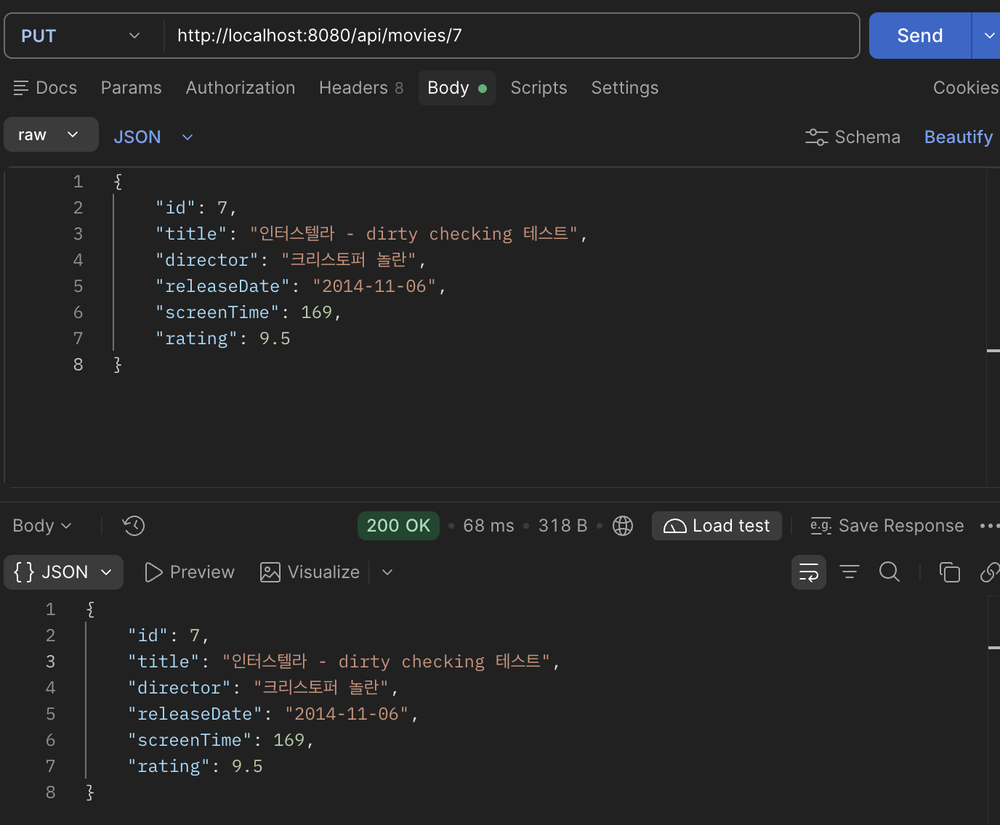
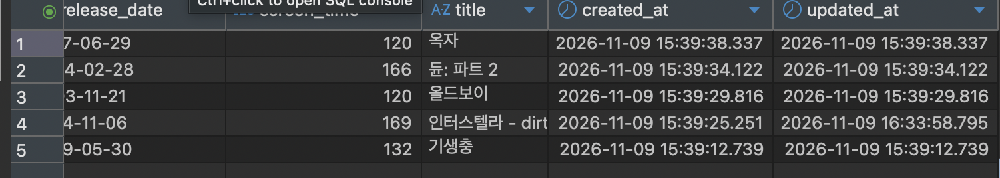

## 프로젝트 소개
### 프로젝트 주제 및 주요 기능 
- 영화 정보를 관리하는 CRUD 프로그램이다. 영화를 생성, 조회, 수정, 삭제하는 기능에 더하여, 
ID로 조회, 전체 조회, 제목으로 조회, 감독 + 평점 조건 조회 등 다양한 CRUD 기능을 Query Method를 이용하여 구현하였다.
- JPA를 이용하여 CRUD 기능을 이용하였으며, Auditing 기능으로 생성시간과 수정시간을 자동으로 생성되게 만들었다.
- Dirty Checking 을 이용하여 엔티티가 변경될 때 자동으로 저장하도록 구현하였다.

### Github : https://github.com/hc-10103/web10
### Render : https://web10-i3u8.onrender.com/

## 주요 구현 내용 및 결과
### Query Method 3개
1. List<Movie> findByTitle(String title);
- 제목으로 검색
  

2. List<Movie> findByDirectorAndRatingBetween(String director, Float rate1, Float rate2);
- 감독 + 평점구간으로 복합검색
  

3. List<Movie> findAllByOrderByRatingDesc();
- 평점을 기준으로 내림차순 정렬하여 조회
  

### Dirty Checking
```Java
@Transactional
    public MovieResponse update(Long id, MovieRequest movieRequest) {
        Movie movie = movieRepository.findById(id)
                .orElseThrow(() -> new ResponseStatusException(
                        HttpStatus.NOT_FOUND, "Movie not Found " + id));

        movie.update(movieRequest);
        return from(movie);
    }
```
- 수정전
  

- Postman
  

- 수정후
  

### Auditing
```Java
@CreatedDate
@Column(name = "created_at", updatable = false)
private LocalDateTime createdAt;

@LastModifiedDate
@Column(name = "updated_at")
private LocalDateTime updatedAt;
```
- 생성된 시간 결과
  


## Weekly Review
### Key Learning
1. Dirty Checking : JPA의 save 함수를 create, update 시에 항상 직접 호출하는 것이 아니라, 영속성을 지닌 엔티티를 추적하여
해당 엔티티가 변화되는 것을 감지하면 자동으로 변경된 내용을 저장하는 기능이다. save 함수를 직접 호출하지 않아도 update 기능을 구현할 수 있다.
2. Auditing : 엔티티가 생성될 때 생성시간이 자동으로 만들어지며, 또한 해당 엔티티가 수정될 때 마지막으로 수정된 시간도 추가할 수 있는 기능이다.
3. Query Method : 복잡한 CRUD 기능을 구현할 때 편하게 SQL문을 작성할 수 있게 해주는 문법이다. 만약 감독과 평점 구간의 데이터만 조회하는 기능을 구현하고자 한다면,
findByDirectorAndRatingBetween(감독, 최저평점, 최고평점) 형식으로 작성할 수 있다.

### Problem & Solution
- 처음 Query Method를 작성하기 위해 문법을 공부하는 과정이 어려웠다. 문법 공부기 때문에 AI와 다양한 상황의 코드를 함께 짜보며 공부하여 해결하였다.

### Reflection 
- CRUD 기능을 쉽게 구현하기 위한 다양한 프레임워크가 존재함을 느꼈다. 많이 써보고, 익숙해지는 것이 개발실력을 늘리는 게 가장 빠르고 효율적인 방법임을 깨닫게 되었다.

## AI usage
- codex, 'Query Method에서 평점이 5점 이상인 데이터만 가져오는 법 알려줘', 'Auditing 기능 추가했는데 서버 실행하다가 에러가 나 어디가 문제야?',
'@EntityListeners 어노테이션은 어떤 기능을 하는 어노테이션이야?'
- query Method 부분을 공부하는 과정에서 AI가 제공한 답안을 받고 공부하였다. 이후 해당 함수를 변형하여 나만의 코드로 작성하였다. 예를 들어 평점 구간을 5점 이상인 필드만 가져오는 코드를 공부했다면,
직접 잘 때는 구간을 변경해보기도 하고, 또 제목이랑 복합검색을 해보기도 하는 형식으로 다양하게 변경한 코드를 작성해보았다.
- AI 사용 비율은 약 30% 정도이며 학습을 위한 용도로 주로 사용하였다.
