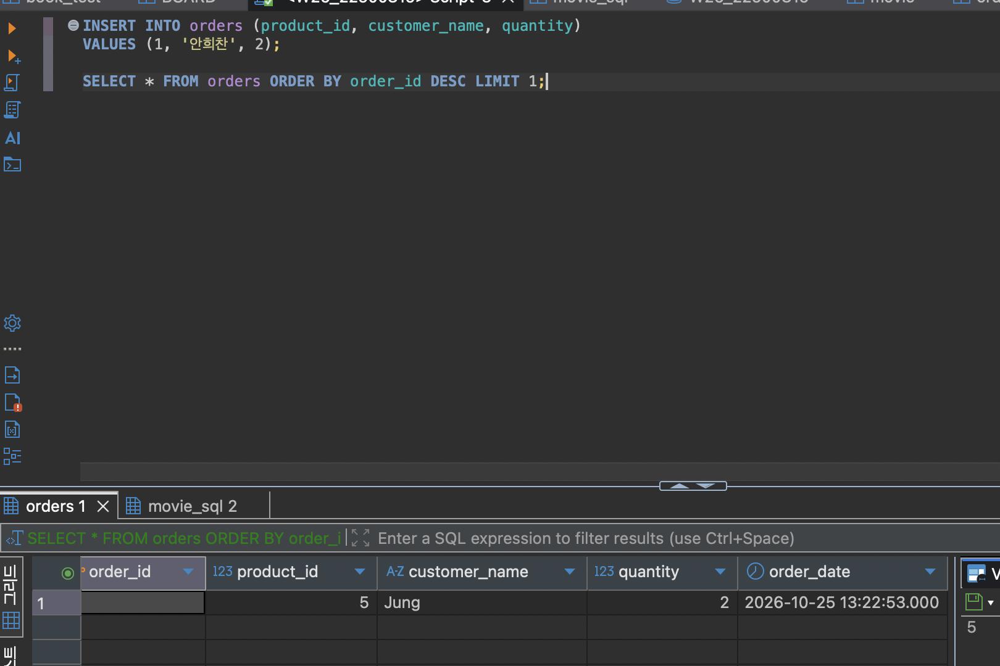
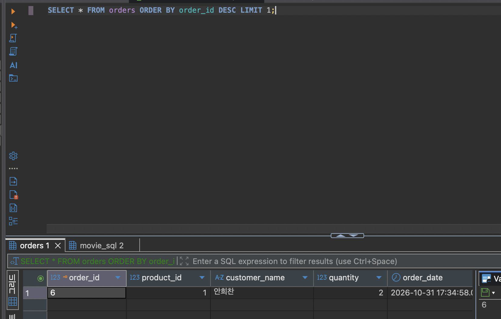
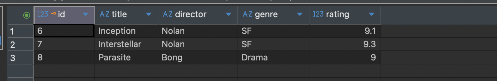
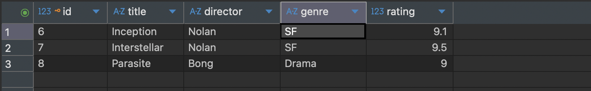
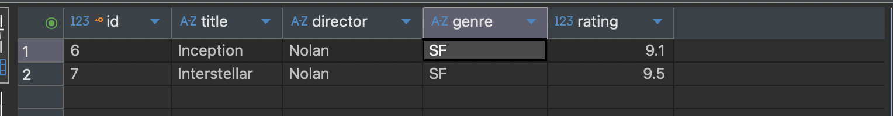
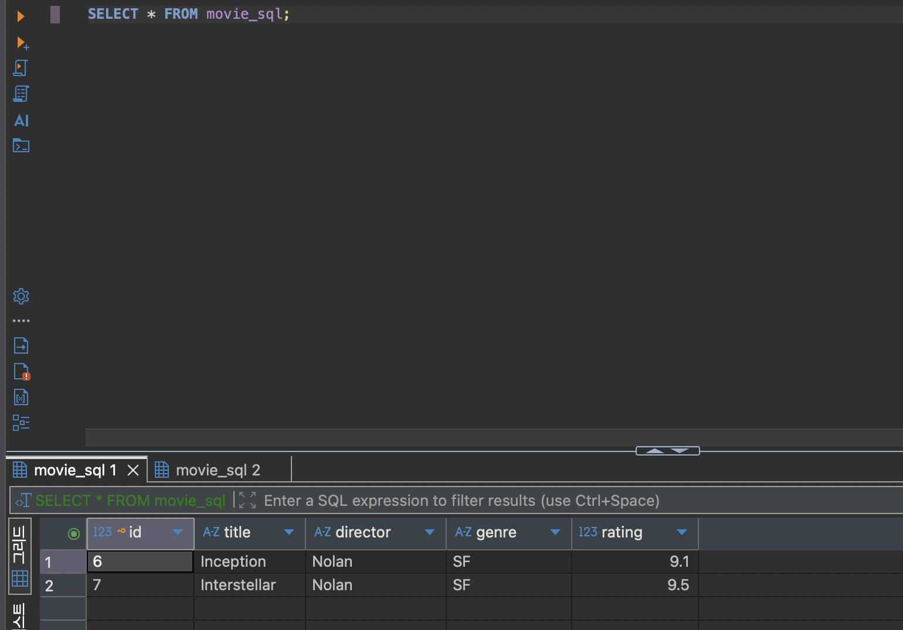
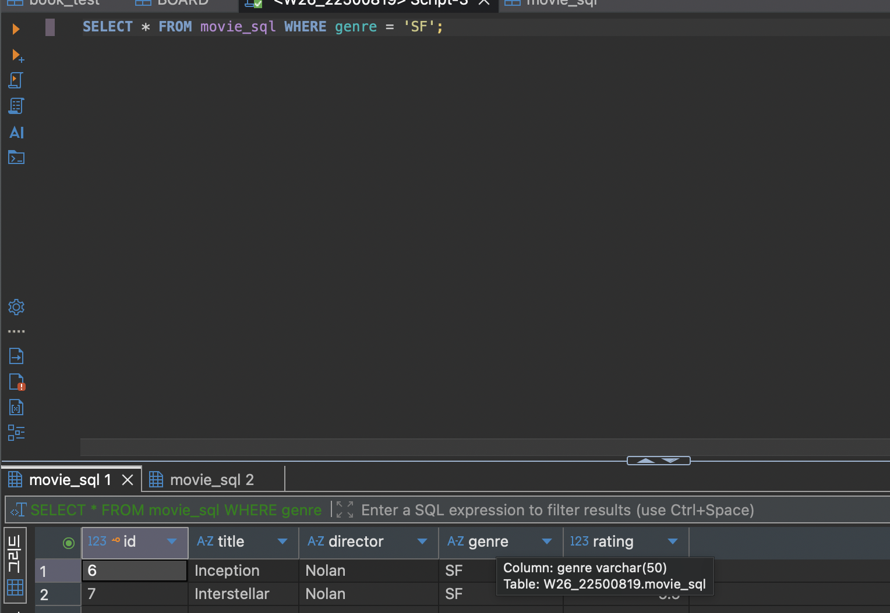
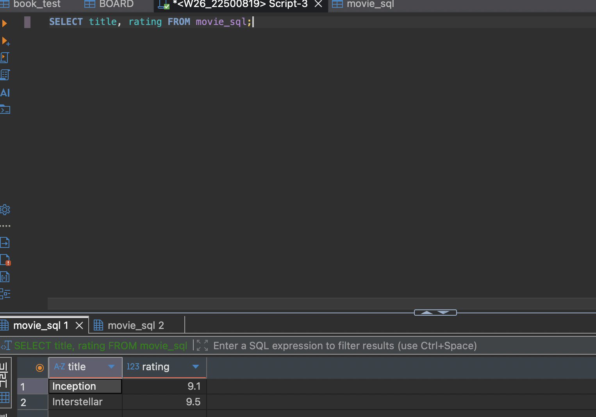

# Movie Management 프로젝트 보고서

# ① 프로젝트 소개

## 주제 및 주요 기능
영화 정보를 등록하고 조회·수정·삭제하는 REST API 프로젝트이다.
Spring Boot와 Spring Data JPA를 사용하여 요청을 처리하고, MariaDB에 영화 정보를 저장하도록 구현하였다.

## Entity 필드 구조

| 필드 | Java 타입 | MariaDB 컬럼 | 설명 |
|---|---|---|---|
| id | Long | id / BIGINT | 기본키, 자동 증가 |
| title | String | title / VARCHAR(200) | 영화 제목, NOT NULL |
| director | String | director / VARCHAR(100) | 감독, NOT NULL |
| releaseDate | String | release_date / VARCHAR(100) | 개봉일, NOT NULL |
| screenTime | Integer | screen_time / INT | 상영 시간(분), NOT NULL |
| rating | Float | rating / FLOAT | 평점, NULL 허용 |

## 프로젝트 구조 및 개발환경

```text
src/main/java/org/example/jpa_project/
├── JpaProjectApplication.java
├── controller/MovieController.java
├── dto/MovieRequest.java
├── dto/MovieResponse.java
├── entity/Movie.java
├── repository/MovieRepository.java
└── service/MovieService.java
src/main/resources/application.properties
src/test/java/org/example/jpa_project/JpaProjectApplicationTests.java
Dockerfile
build.gradle
```

- controller: HTTP 요청을 받고 응답 반환
- dto: 영화 등록·수정 요청과 응답 데이터 정의
- entity: MariaDB 테이블에 매핑할 Movie 정의
- repository: DB 조회 및 저장 기능 제공
- service: 영화 관리 로직과 예외 처리
- resources: DB 연결 및 서버 설정 관리

Java 17, Spring Boot 4.1.2, Gradle 9.8.2, Spring Data JPA와 Hibernate를 사용하였다. IntelliJ IDEA에서 개발하고 Postman으로 요청을 전송하며, DBeaver로 SQL 실행 결과를 확인한다. 배포용 Dockerfile은 Java 17 기반으로 작성하였다. 연결 로그에서 확인한 MariaDB 서버 버전은 10.1.48이다.

- GitHub Repository URL: https://github.com/2026-2-WebService/assign09-c01-22500819
- Render Deployment URL: https://web9-xben.onrender.com
- API 기본 경로: `/api/movies`

# ② Database SQL Practice

## 1. 기존 Table 조회 및 데이터 추가

### INSERT

```sql
INSERT INTO orders (product_id, customer_name, quantity)
VALUES (1, '안희찬', 2);
```



### SELECT

```sql
SELECT * FROM orders ORDER BY order_id DESC LIMIT 1;
```



`order_id=6`, `product_id=1`, `customer_name=안희찬`, `quantity=2`인 주문을 확인하였다.

## 2. 새 Table 생성 SQL

```sql
CREATE TABLE movie_sql (
    id BIGINT AUTO_INCREMENT PRIMARY KEY,
    title VARCHAR(200) NOT NULL,
    director VARCHAR(100) NOT NULL,
    genre VARCHAR(50),
    rating FLOAT
);
```

## 3. INSERT / UPDATE / DELETE / SELECT SQL과 실행 결과

```sql
INSERT INTO movie_sql (title, director, genre, rating)
VALUES
    ('Inception', 'Nolan', 'SF', 9.1),
    ('Interstellar', 'Nolan', 'SF', 9.3),
    ('Parasite', 'Bong', 'Drama', 9.0);
```



### UPDATE

```sql
UPDATE movie_sql SET rating = 9.5 WHERE id = 7;
SELECT * FROM movie_sql;
```



### DELETE

```sql
DELETE FROM movie_sql WHERE id = 8;
SELECT * FROM movie_sql;
```



### SELECT — 전체 조회

```sql
SELECT * FROM movie_sql;
```



### SELECT — 장르 조건 조회

```sql
SELECT * FROM movie_sql WHERE genre = 'SF';
```



### SELECT — 제목과 평점만 조회

```sql
SELECT title, rating FROM movie_sql;
```



# ③ Spring Data JPA 구현

## Entity 및 JpaRepository 설명
`Movie`는 `movie` 테이블에 매핑되는 Entity이다. `MovieRepository`는 `JpaRepository<Movie, Long>`을 상속하여 저장·조회·삭제 기능을 제공한다.

## 사용한 Annotation의 역할

| Annotation | 역할 |
|---|---|
| `@SpringBootApplication` | 자동 설정 및 컴포넌트 스캔을 포함한 실행 진입점 |
| `@Entity` | JPA가 관리하는 Entity 지정 |
| `@Id` | 기본키 지정 |
| `@GeneratedValue(strategy = GenerationType.IDENTITY)` | DB의 자동 증가 키 사용 |
| `@Column` | 컬럼의 NOT NULL, 길이 등 지정 |
| `@Service` | 서비스 객체를 Spring Bean으로 등록 |
| `@RestController` | API 요청 처리 및 응답 본문 반환 |
| `@RequestMapping` | 공통 요청 경로 지정 |
| `@GetMapping`, `@PostMapping`, `@PutMapping`, `@DeleteMapping` | HTTP 메서드별 요청 연결 |
| `@RequestBody` | JSON을 요청 DTO로 변환 |
| `@PathVariable` | URL의 ID를 메서드 인자로 전달 |
| `@Valid` | 요청 DTO의 검증 조건 검사 |
| `@NotBlank` | 문자열이 null, 빈 문자열 또는 공백뿐인 값인지 검사 |
| `@Size` | 문자열 길이 등 크기 제한 검사 |


## REST API Endpoint 목록 및 요청·응답 JSON

| Method | Endpoint | 기능 | 정상 응답 설계 |
|---|---|---|---|
| POST | `/api/movies` | 영화 등록 | 201 Created, 영화 객체 |
| GET | `/api/movies` | 전체 조회 | 200 OK, 영화 배열 |
| GET | `/api/movies/{id}` | 상세 조회 | 200 OK, 영화 객체 |
| PUT | `/api/movies/{id}` | 영화 수정 | 200 OK, 수정한 영화 객체 |
| DELETE | `/api/movies/{id}` | 영화 삭제 | 204 No Content, 본문 없음 |


### 등록 요청과 응답

```json
{
  "title": "인터스텔라",
  "director": "크리스토퍼 놀란",
  "releaseDate": "2014-11-06",
  "screenTime": 169,
  "rating": 9.0
}
```

정상 등록 시 응답 객체 예시:

```json
{
  "id": 1,
  "title": "인터스텔라",
  "director": "크리스토퍼 놀란",
  "releaseDate": "2014-11-06",
  "screenTime": 169,
  "rating": 9.0
}
```

### 전체·상세 조회
전체 조회는 다음처럼 객체 배열을 반환하고, 상세 조회는 위 등록 응답과 같은 형태의 객체 한 개를 반환한다.

```json
[
  {
    "id": 1,
    "title": "인터스텔라",
    "director": "크리스토퍼 놀란",
    "releaseDate": "2014-11-06",
    "screenTime": 169,
    "rating": 9.0
  }
]
```

### 수정 요청과 응답

```json
{
  "title": "인터스텔라",
  "director": "크리스토퍼 놀란",
  "releaseDate": "2014-11-06",
  "screenTime": 169,
  "rating": 9.5
}
```

정상 수정 시 응답은 ID와 변경된 평점을 포함한 영화 객체이다. 삭제 요청은 본문 없이 전송하며 정상 처리 시 응답 본문도 없다.

## JPA Entity와 MariaDB Table 비교
Movie 객체 한 개는 movie 테이블의 한 행에 대응한다. `releaseDate`와 `screenTime`은 `release_date`, `screen_time` 컬럼으로 매핑된다. SQL 실습은 별도 테이블인 `movie_sql`을 사용하였다.

# ④ JPA와 SQL 비교

## save(), findAll(), findById(), deleteById() 사용 결과

| 메서드 | 코드의 사용 방식 | 결과 및 확인 기준 |
|---|---|---|
| `save()` | 새 Movie 저장, 수정한 Movie 저장 | 생성 ID 또는 변경값을 응답 DTO로 반환 |
| `findAll()` | 목록 조회 후 DTO 배열로 변환 | 영화 목록 반환, 데이터가 없으면 빈 배열 |
| `findById()` | ID로 조회 후 DTO 변환 | 존재하면 객체 반환, 상세 조회에서 없으면 404 |
| `deleteById()` | 존재 여부 확인 후 삭제 | 정상 삭제 시 Controller에서 204 반환 |


## 실제 Hibernate SQL 확인
다음은 기존 실행 로그에서 확인한 SQL이다.

```sql
select
    m1_0.id, m1_0.director, m1_0.rating,
    m1_0.release_date, m1_0.screen_time, m1_0.title
from movie m1_0;

insert into movie
    (director, rating, release_date, screen_time, title)
values (?, ?, ?, ?, ?);
```

물음표는 실제 데이터가 바인딩되는 자리이다. `spring.jpa.show-sql=true`와 SQL 정렬 설정을 통해 콘솔에서 쿼리를 읽을 수 있게 하였다. 


## SQL 직접 작성 방식과 JPA 방식의 차이
SQL은 쿼리를 직접 작성하고, JPA는 Entity와 Repository 메서드로 데이터를 처리한다. JPA가 생성한 SQL은 Hibernate 로그에서 확인할 수 있다.

# ⑤ 배포 및 환경 설정

## IntelliJ 및 Render 환경변수 설정 방법

| 변수명 | 용도 |
|---|---|
| `DB_URL` | MariaDB JDBC 연결 주소 |
| `DB_USERNAME` | DB 접속 계정 |
| `DB_PASSWORD` | DB 접속 비밀번호 |
| `PORT` | 서버 포트, 미지정 시 기본 8080 |


- IntelliJ: `실행 → 구성 편집 → 환경 변수` 등록, gradlew 옵션은 `bootRun`.
- Render: 서비스의 `Environment`에서 DB 환경변수 등록.

## Render 배포 과정
GitHub 저장소 연결 → Dockerfile로 JAR 빌드 → 환경변수 등록 → 배포 URL에서 API 확인.

## 배포 URL의 CRUD 테스트 결과

create
```json
[
  {
    "id": 1,
    "title": "배고프다",
    "director": "안희찬",
    "releaseDate": "2026-07-29",
    "screenTime": 150,
    "rating": 5.0
  }
]
```
update
```json
[
  {
    "id": 1,
    "title": "배고프다",
    "director": "안희찬",
    "releaseDate": "2026-07-29",
    "screenTime": 120,
    "rating": 3.0
  }
]
```
get(update 후)
```json
[
  {
    "id": 1,
    "title": "배고프다",
    "director": "안희찬",
    "releaseDate": "2026-07-29",
    "screenTime": 150,
    "rating": 5.0
  }
]
```

## MariaDB 데이터 저장 확인
실행 로그에서 MariaDB 연결 성공과 Hibernate SELECT·INSERT SQL을 확인하였다.

# ⑥ Weekly Report

## Key Learning
1. DB를 연결할때 JPA를 사용하여 연결한다.
2. 환경변수를 설정하여 DB 정보를 넘긴다. 직접 입력하지 않도록 주의한다.
3. Render에도 환경 변수를 직접 입력하지 않고 설정 과정을 거쳐 배포하여야 한다.

## Problem & Solution
개발할 떄 익숙치 않은 프레임워크를 사용하는 도중 DB를 연결하는 과정에서 AI의 도움을 받다가 구조가 엉켜버려서 다시 작업해야했다.
AI한테 도움을 받을 때 자세하게 설명하여 엉키지 않게 하는 것이 중요한 것같다.

## Code Review
```java
    @Id
    @GeneratedValue(strategy = GenerationType.IDENTITY)
    private Long id;

    @Column(nullable = false, length = 200)
    private String title;

    @Column(nullable = false, length = 100)
    private String director;

    @Column(nullable = false, length = 100)
    private String releaseDate;

    @Column(nullable = false, length = 100)
    private Integer screenTime;

    @Column(nullable = true)
    private Float rating;
```
데이터를 관리할 때 null 가능 여부, 길이 지정 등 여러 조건을 달 수 있다.

## AI Usage
프로젝트 빌드할 때 생긴 오류 수정, JPA 사용법 관련 질문에 주로 사용하였다.
약 30% 정도 사용하였다.

## Reflection
어노테이션을 점차 익숙하게 사용할 수 있도록 연습해야겠다.
